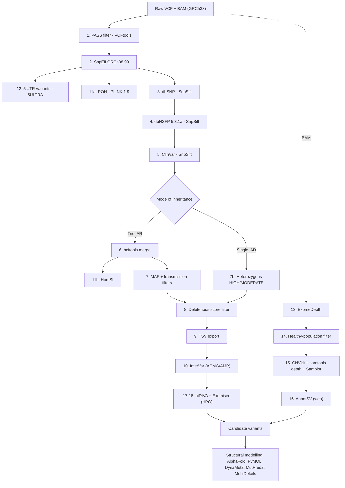

# WES Tertiary Analysis Pipeline

An optimized, reproducible pipeline for the **tertiary analysis of whole-exome sequencing (WES)** data in rare genetic diseases. Starting from variant calls (VCF) and alignments (BAM), it annotates, filters, classifies and prioritizes **SNVs/indels**, and detects and validates **copy-number variants (CNV)** and **runs of homozygosity (ROH)**, including in consanguineous families.

> Developed within a Master's thesis in Bioinformatics (Bio Data Analytics), ISBST, University of La Manouba, at the Laboratory of Biomedical Genomics and Oncogenetics (LR16IPT05), Institut Pasteur de Tunis. Applied to two atypical rare-disease cases (an atypical Gaucher disease trio and a neurofibromatosis type 1 patient).

## Highlights

- Trio (autosomal recessive) and single-patient (autosomal dominant) analysis modes
- Up-to-date resources: dbNSFP 5.3.1a (AlphaMissense, REVEL, CADD, BayesDel...), ClinVar 2026
- Non-coding modules: 5'UTR (5ULTRA), splicing and intergenic annotation
- ROH detection (PLINK, HomSI) for consanguinity-driven recessive diseases
- CNV detection (ExomeDepth) with multi-method validation (CNVkit, samtools depth, Samplot) and healthy-population filtering
- Automated ACMG/AMP classification (InterVar) and AI/HPO-based prioritization (aiDIVA, Exomiser)

## Pipeline overview



## Repository structure

```
.
├── config/config.example.sh      # paths to tools and databases (copy to config.sh)
├── environment/                  # conda/micromamba environments
│   ├── core.yml                  # VCFtools, bcftools, samtools, PLINK, SnpEff/SnpSift, Samplot
│   ├── cnvkit.yml                # CNVkit (Python <= 3.10)
│   └── exomedepth.yml            # ExomeDepth (R)
├── scripts/                      # one script per pipeline step
├── templates/                    # Exomiser analysis template, HPO list example
├── docs/                         # troubleshooting, external resources
├── LICENSE
└── CITATION.cff
```

## Requirements

| Component | Version used |
|---|---|
| VCFtools | 0.1.17 |
| SnpEff / SnpSift | 5.x (GRCh38.99) |
| PLINK | 1.9 |
| HomSI | Java application (Gormez et al., 2014) |
| bcftools, samtools, bedtools, htslib | recent releases |
| dbNSFP | 5.3.1a (GRCh38) |
| dbSNP | v156 (GRCh38) |
| ClinVar | 2026-05 release |
| InterVar + ANNOVAR | with `humandb` for hg38 |
| ExomeDepth | R package |
| CNVkit | 0.9.x |
| Samplot | 1.3.0 |
| aiDIVA | random forest, scikit-learn 1.3.2 |
| Exomiser | 14.0.0 |

Third-party tools and databases are **not redistributed**: install them from their own sources and respect their licences (for example, **5ULTRA** is CC BY-NC-ND).

## Installation

```bash
git clone https://github.com/islemsellami/WES-Tertiary-Analysis-Pipeline.git
cd WES-Tertiary-Analysis-Pipeline
chmod +x scripts/*.sh scripts/*.py scripts/*.R

# create the environments (micromamba shown; conda works the same way)
micromamba env create -f environment/core.yml
micromamba env create -f environment/cnvkit.yml
micromamba env create -f environment/exomedepth.yml

# configure your paths
cp config/config.example.sh config/config.sh
nano config/config.sh
```

## Usage

Each step is an independent script that reads `config/config.sh`. Example for a single patient:

```bash
export SAMPLE=sample1
export RAW_VCF=/path/to/sample1.vcf.gz

./scripts/01_filter_pass.sh
./scripts/02_snpeff_annotation.sh
./scripts/03_snpsift_dbsnp.sh
./scripts/04_snpsift_dbnsfp.sh
./scripts/05_snpsift_clinvar.sh
./scripts/07b_single_ad_filter.sh      # autosomal dominant, proband only
./scripts/08_deleterious_filter.sh
./scripts/09_extract_fields.sh
./scripts/10_intervar_acmg.sh
```

For a **trio** (autosomal recessive), run steps 1-5 for each member, then:

```bash
export FAMILY=fam1 PROBAND=fam1-P MOTHER=fam1-M FATHER=fam1-F
./scripts/06_trio_merge.sh
./scripts/07_trio_inheritance_filters.sh
SAMPLE=$PROBAND ./scripts/11_roh_plink_homsi.sh plink
./scripts/11_roh_plink_homsi.sh homsi
MODE=trio ./scripts/09_extract_fields.sh
```

CNV analysis from the BAM files:

```bash
SAMPLE=sample1 PATIENT_BAM=/path/sample1.bam ./scripts/13_exomedepth.sh
SAMPLE=sample1 ./scripts/14_cnv_population_filter.sh
SAMPLE=sample1 BAM=/path/sample1.bam CHR=chr17 START=1000000 END=1010000 \
  FLANK_START=900000 FLANK_END=999999 ./scripts/15_cnv_validation.sh
```

Prioritization:

```bash
SAMPLE=sample1 HPO_LIST=templates/hpo_terms_example.txt ./scripts/17_aidiva_run.sh
SAMPLE=sample1 ANALYSIS_YML=/path/analysis.yml ./scripts/18_exomiser_run.sh
```

## Pipeline steps

| # | Step | Tool | Output |
|---|---|---|---|
| 1 | Keep PASS variants | VCFtools | `step1.recode.vcf` |
| 2 | Functional annotation (HGVS, impact) | SnpEff | `step2.snpeff.vcf` |
| 3 | rsIDs | SnpSift + dbSNP | `step3.dbsnp.vcf` |
| 4 | 16 pathogenicity / conservation scores | SnpSift + dbNSFP | `step4.dbnsfp.vcf` |
| 5 | Clinical annotation | SnpSift + ClinVar | `step5.clinvar.vcf` |
| 6 | Trio merge | bcftools | `trio.merged.vcf` |
| 7 / 7b | MAF and transmission filters (AR trio / AD single) | SnpSift | `trio.AR.final.vcf`, `*.AD.het.vcf` |
| 8 | Deleterious variants (CADD, REVEL, AlphaMissense, BayesDel) | SnpSift | `step8.deleterious.vcf` |
| 9 | 31-column TSV | SnpSift | `extract_*.tsv` |
| 10 | ACMG/AMP classification | InterVar | `*_intervar.tsv` |
| 11 | ROH | PLINK, HomSI | `*.hom`, HomSI plots |
| 12 | 5'UTR variants | 5ULTRA | `*.5ultra.tsv` |
| 13 | CNV detection | ExomeDepth | `CNV_raw_*.csv` |
| 14 | Healthy-population filter | bedtools | `CNV_*_not_in_population.bed` |
| 15 | CNV validation | CNVkit, samtools, Samplot | figures, coverage ratio |
| 16 | CNV annotation | AnnotSV (web) | annotated TSV |
| 17 | AI + HPO prioritization | aiDIVA | `aiDIVA_results/` |
| 18 | HPO prioritization | Exomiser | `Exomiser/` |

Deleterious-score thresholds: CADD > 20 (Kircher et al., 2014); REVEL > 0.5 (Ioannidis et al., 2016); AlphaMissense > 0.564 (Cheng et al., 2023); BayesDel_noAF > 0.069 (Kong et al., 2025). A variant is kept if it satisfies at least one validated combination and has HIGH or MODERATE impact.

See [`docs/troubleshooting.md`](docs/troubleshooting.md) for known issues and [`docs/external_resources.md`](docs/external_resources.md) for the web resources used during interpretation.

## Data privacy and ethics

No patient data (VCF, BAM, CNV calls, TSV tables) is included in this repository, and the `.gitignore` excludes them. Patients were recruited with written informed consent; the study was approved by the ethics committee (code ETHIQUE-HCN-056-2025). Never commit identifiable data, sample names linked to patients, or local paths.

## Citation

If you use this pipeline, please cite:

> Sellami I. *Optimization of a genomic analysis pipeline for the characterization of pathogenic variants: applications to lysosomal and neurocutaneous diseases.* Master's thesis in Bioinformatics, ISBST, University of La Manouba; Institut Pasteur de Tunis; 2026.

A machine-readable citation is provided in [`CITATION.cff`](CITATION.cff).

## License

Released under the [MIT License](LICENSE). Third-party tools keep their own licences.

## Contact

Islem Sellami - Master's student, Bioinformatics (Bio Data Analytics), ISBST, University of La Manouba  
Supervisor: Dr Lilia Romdhane, LR16IPT05, Institut Pasteur de Tunis
